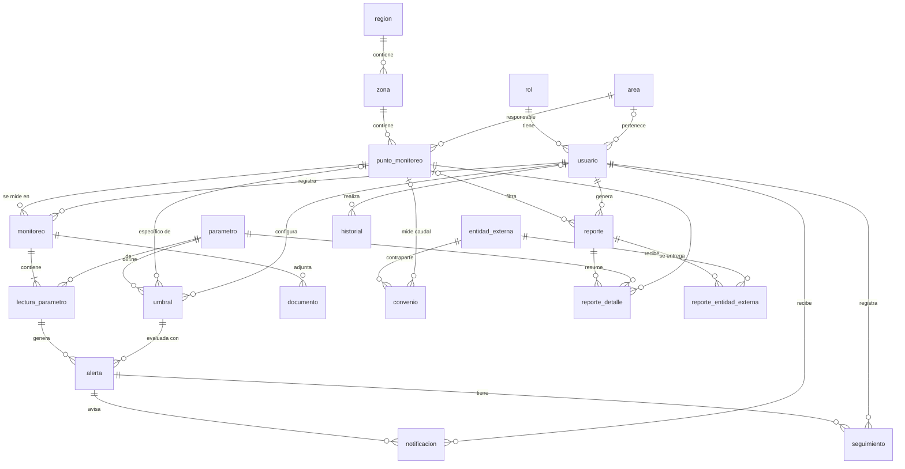

# Guía para el responsable de Base de Datos

Esta guía explica cómo construir la base de datos para que funcione con el backend **sin tocar código Java**.

## 1. Lo esencial en 30 segundos

- El diseño de la base **ya está hecho y es la referencia**: `src/main/resources/db/migration/V1__esquema.sql` (21 tablas) y `V2__datos_iniciales.sql` (roles, administrador, parámetros, entidades).
- El backend **arranca verificando** que cada tabla y columna exista con el tipo correcto (`ddl-auto=validate`). Si algo no coincide, no arranca y el error dice exactamente qué falta. Eso es tu "prueba automática".
- Tu entregable es el script SQL (y el diagrama/diccionario para la tesis). Puedes mejorarlo (índices, vistas, comentarios, procedimientos), **pero sin cambiar nombres ni tipos** de lo que ya existe.

Documentos de apoyo en esta carpeta:

| Archivo | Para qué |
|---|---|
| `DICCIONARIO_DE_DATOS.md` | Todas las tablas y columnas, con tipo, nulos, valores por defecto, FK e índices |
| `sql/01_usuarios_mysql.sql` | Usuarios de MySQL con permisos separados (migración vs. aplicación) |
| `sql/02_consultas_utiles.sql` | Consultas para revisar datos y para capturas de la tesis |
| `DECISIONES.md` | Qué cambió respecto al modelo del informe y por qué |

## 2. Diagrama entidad-relación

(GitHub y VS Code muestran este diagrama automáticamente. Para la tesis puedes exportarlo desde <https://mermaid.live> o rehacerlo en MySQL Workbench con *Database → Reverse Engineer* una vez creada la base).

## 3. Reglas que el backend necesita (no negociables)

1. **Nombres exactos** de tablas y columnas, en minúsculas con guion bajo (ver diccionario).
2. **Tipos compatibles**:
   - IDs: `INT AUTO_INCREMENT` (excepto `lectura_parametro.id_lectura` e `historial.id_historial`, que son `BIGINT`).
   - Decimales: `DECIMAL(p,s)`. Fechas con hora: `DATETIME`. Fechas sin hora: `DATE`.
   - Textos largos: `zona.poligono_geojson` es `MEDIUMTEXT`; `historial.datos_anteriores/datos_nuevos` son `TEXT`.
3. **Estados y tipos como `VARCHAR`**, nunca `ENUM` de MySQL. Guardan exactamente estos valores:

   | Columna(s) | Valores permitidos |
   |---|---|
   | `estado` de catálogos, usuario, monitoreo, lectura, documento, umbral, convenio | `ACTIVO`, `INACTIVO` |
   | `rol.nombre` | `ADMINISTRADOR`, `SUPERVISOR`, `GERENTE`, `AUDITOR` |
   | `zona.tipo_zona` | `POBLADO`, `COMPONENTE`, `AREA_INFLUENCIA` |
   | `monitoreo.tipo_muestreo` | `MANUAL`, `SEMIAUTOMATICO`, `SENSOR_IOT` |
   | `alerta.nivel` | `MEDIA`, `ALTA` |
   | `alerta.tipo_alerta` | `MAXIMO_EXCEDIDO`, `MINIMO_EXCEDIDO` |
   | `alerta.estado`, `seguimiento.estado_*` | `ABIERTA`, `EN_REVISION`, `CERRADA` |
   | `notificacion.canal` | `PANEL`, `CORREO` |
   | `entidad_externa.tipo_entidad` | `REGULADOR`, `FISCALIZADOR`, `EMPRESA_SANEAMIENTO`, `OTRO` |
   | `convenio.tipo_meta` | `PROMEDIO_ANUAL` |
   | `reporte.tipo_reporte` | `AMBIENTAL`, `AUDITORIA`, `ESPECIAL` |
   | `reporte.formato` | `PDF`, `XLSX` |
   | `reporte.estado` | `GENERADO`, `ANULADO` |
   | `reporte_entidad_externa.medio` | `CORREO`, `MESA_DE_PARTES`, `PLATAFORMA_VIRTUAL`, `OTRO` |
   | `historial.accion` | `CREAR`, `MODIFICAR`, `CAMBIAR_ESTADO`, `LOGIN`, `LOGIN_FALLIDO`, `CAMBIAR_PASSWORD`, `GENERAR`, `EXPORTAR`, `SUBIR_ARCHIVO` |

   Si quieres reforzarlo en la base, puedes añadir `CHECK (estado IN ('ACTIVO','INACTIVO'))`; no afecta al backend.
4. **Datos obligatorios** (V2): los 4 roles, el parámetro con código `CAUDAL` (lo usa el cálculo del convenio) y al menos un usuario administrador.
5. **Nada se borra físicamente**: el sistema "elimina" cambiando `estado`. Por eso las FK usan el comportamiento por defecto (`RESTRICT`); no uses `ON DELETE CASCADE`.
6. **Juego de caracteres** `utf8mb4` y fechas en **hora de Perú** (el backend guarda en `America/Lima`).

## 4. Cómo trabajar (elige una opción)

### Opción A — Recomendada: el backend aplica tus scripts (Flyway)

Flyway ejecuta automáticamente los archivos de `src/main/resources/db/migration` en orden (`V1`, `V2`, `V3`...) y anota en la tabla `flyway_schema_history` cuáles ya aplicó.

1. Edita/mejora `V1__esquema.sql` y `V2__datos_iniciales.sql` **antes** de que el equipo los use en sus PCs.
2. Levanta MySQL: `docker compose up -d db` (queda en `localhost:3307`, usuario `smcv_app` / `smcv_dev`, base `ptar_enlozada`).
3. Arranca el backend (ver README). Si tu script tiene un error, Flyway lo muestra en consola y el backend no arranca.
4. Una vez que un V ya se aplicó en alguna base, **no se edita**: cualquier cambio posterior va en un archivo nuevo, por ejemplo `V3__indices_reportes.sql`. Si editas uno ya aplicado, Flyway detecta el cambio de checksum y se niega a arrancar.
5. Para empezar de cero en tu PC: `docker compose down -v` (borra los datos) y `docker compose up -d db`.

### Opción B — Creas la base a mano (Workbench, phpMyAdmin, XAMPP)

1. Crea la base `ptar_enlozada` con `utf8mb4` y ejecuta tu script completo (equivalente a V1 + V2).
2. Desactiva Flyway en el backend con la variable de entorno `FLYWAY_ENABLED=false`.
3. Arranca el backend: si algo no coincide verás un error como
   `Schema-validation: missing column [nivel] in table [alerta]` o
   `Schema-validation: wrong column type encountered in column [valor] in table [lectura_parametro]`.
   Corrige y repite hasta que arranque.

En ambos casos, cuando el backend arranca sin errores, la base está correcta.

## 5. Comprobar que todo funciona

Con el perfil `dev`, el backend carga **datos de demostración** al arrancar por primera vez (3 puntos, umbrales de ejemplo, convenio con SEDAPAR, ~45 días de mediciones y alertas). Comprueba con `docs/sql/02_consultas_utiles.sql` que haya datos en `monitoreo`, `lectura_parametro`, `alerta` e `historial`.

Si no quieres esos datos: `DEMO_DATA=false`.

## 6. Qué puedes agregar sin romper nada

- Índices adicionales (por ejemplo, para reportes por fecha).
- Vistas para la tesis (por ejemplo `v_lecturas_detalle`, `v_alertas_abiertas`).
- `CHECK` adicionales, comentarios de tabla/columna (`COMMENT '...'`).
- Procedimientos o eventos de respaldo.
- Tablas nuevas que el backend no use.

Lo que **no** debes hacer: renombrar o quitar tablas/columnas, cambiar tipos, convertir estados a `ENUM`, añadir columnas `NOT NULL` sin valor por defecto a tablas existentes (el backend no las llenaría y fallarían los INSERT).

## 7. Si necesitas cambiar el modelo

Coordínalo con backend: se cambia el script **y** la entidad Java correspondiente (`src/main/java/pe/smcv/ptar/<módulo>/entity/`). Cada entidad indica su tabla con `@Table(name = "...")` y cada campo su columna con `@Column(name = "...")`.
